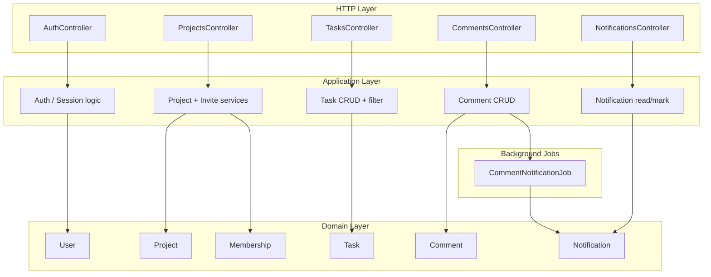
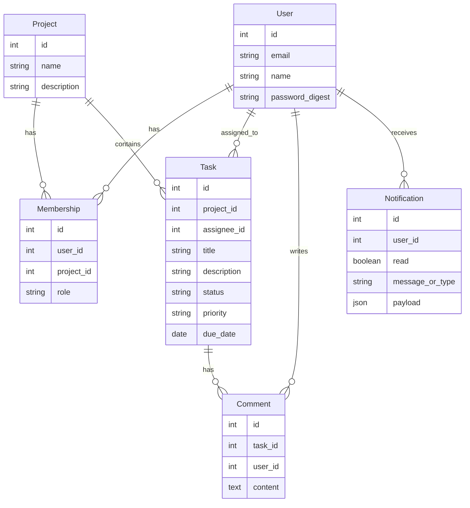

# Victor's Challenge

## Architecture and data flow

---

## Data model

| Model            | Key attributes                                                                                                    | Associations                                                                                                                                    |
| ---------------- | ----------------------------------------------------------------------------------------------------------------- | ----------------------------------------------------------------------------------------------------------------------------------------------- |
| **User**         | email, password_digest, name                                                                                      | has_many memberships; has_many projects through memberships; has_many assigned_tasks (Task assignee); has_many comments; has_many notifications |
| **Project**      | name, description, (optional) user_id for owner                                                                   | has_many memberships; has_many members through memberships; has_many tasks                                                                      |
| **Membership**   | user_id, project_id, role (e.g. owner, member)                                                                    | belongs_to user, project                                                                                                                        |
| **Task**         | project_id, assignee_id, title, description, status (todo/in_progress/done), priority (low/medium/high), due_date | belongs_to project, assignee (User); has_many comments                                                                                          |
| **Comment**      | task_id, user_id, content                                                                                         | belongs_to task, user                                                                                                                           |
| **Notification** | user_id, read (boolean), notifiable_type, notifiable_id or payload (JSON), message                                | belongs_to user                                                                                                                                 |

- **Authorization**: Project member required for project/tasks/comments read and for creating tasks/comments. Only **project owner** can invite. Task **assignee** (or project member, per story) can update status/assignee. Only **comment author** can edit/delete. Notifications scoped to `current_user`.

---

## Domain model sketch

High-level domain entities and relationships (reference for implementation and README):

- **Aggregates**: Project (root: Project, with Memberships and Tasks); Task (with Comments); User (identity + Memberships, assigned Tasks, Notifications). Notifications are standalone, created by jobs.

---
